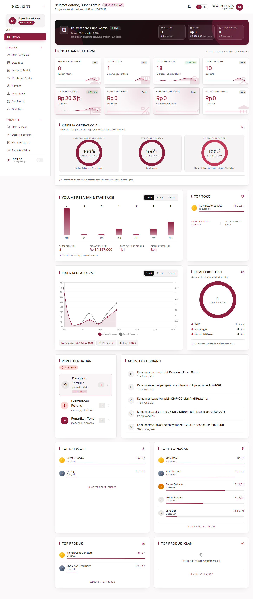
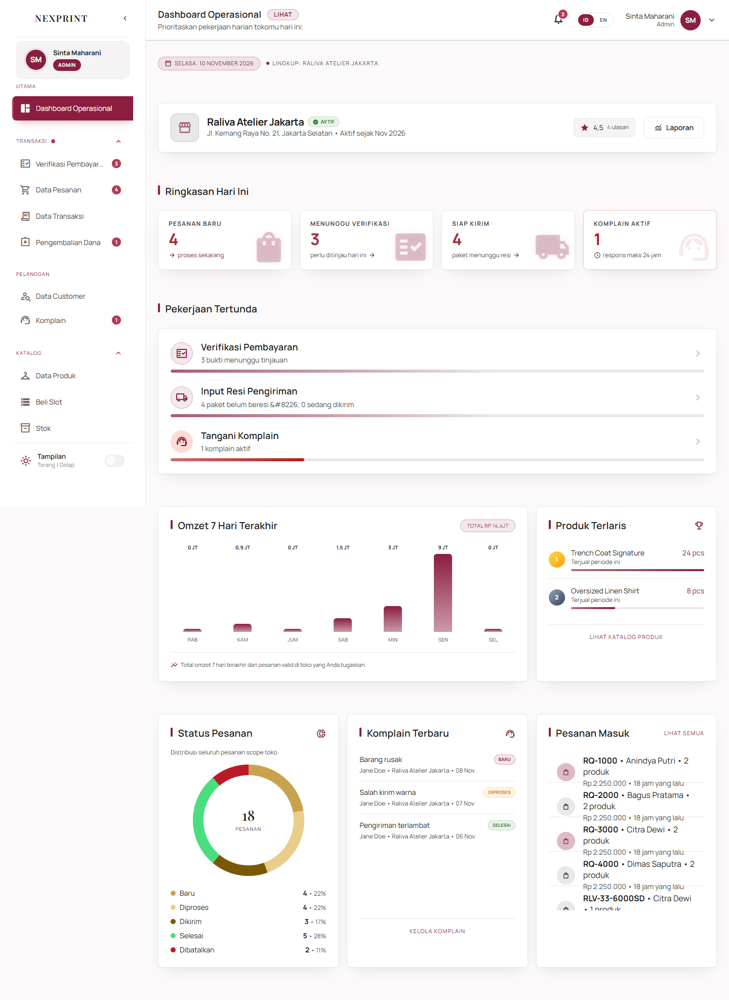
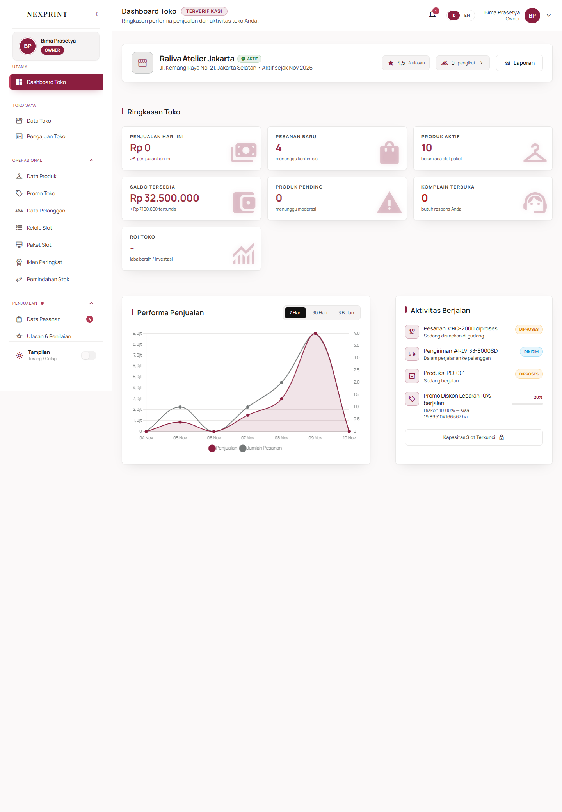
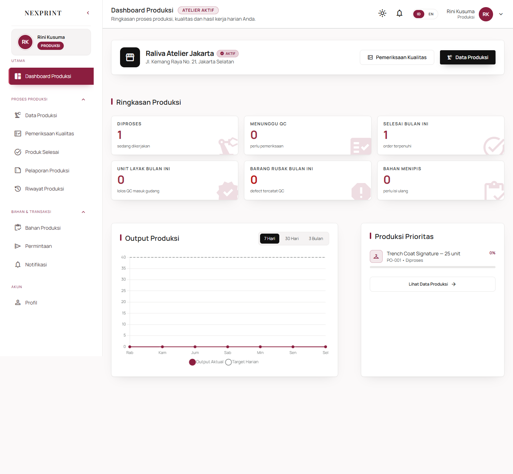
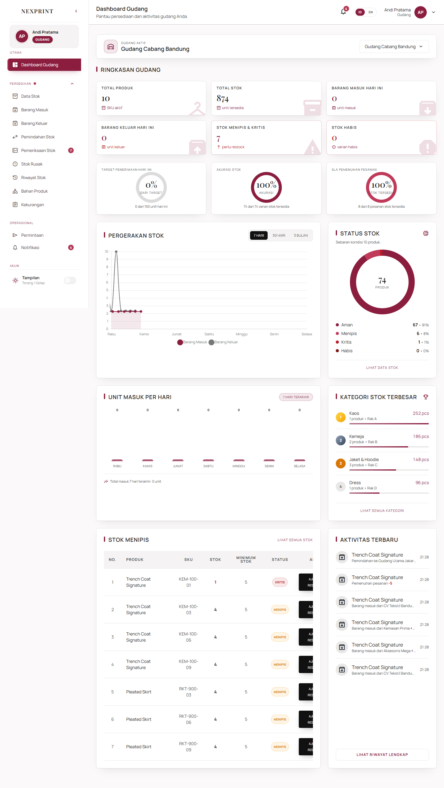
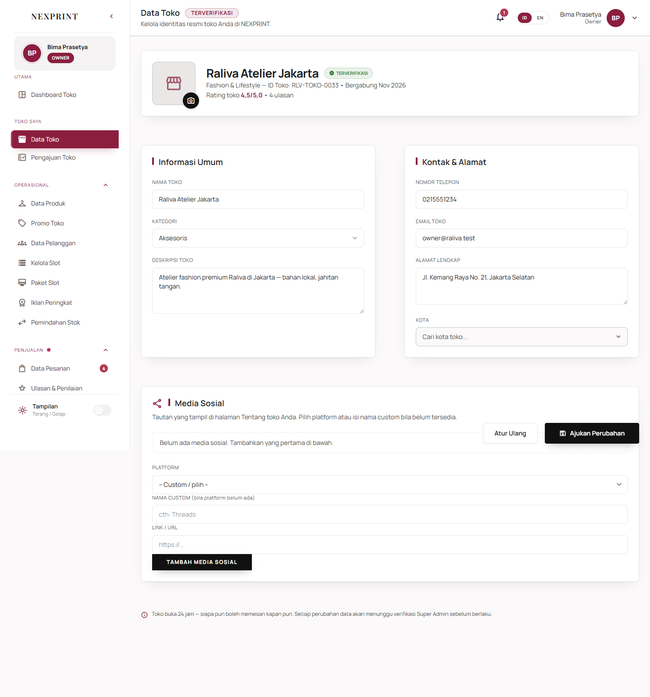
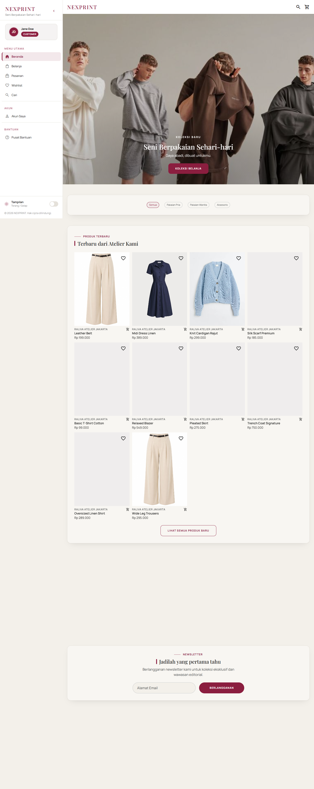
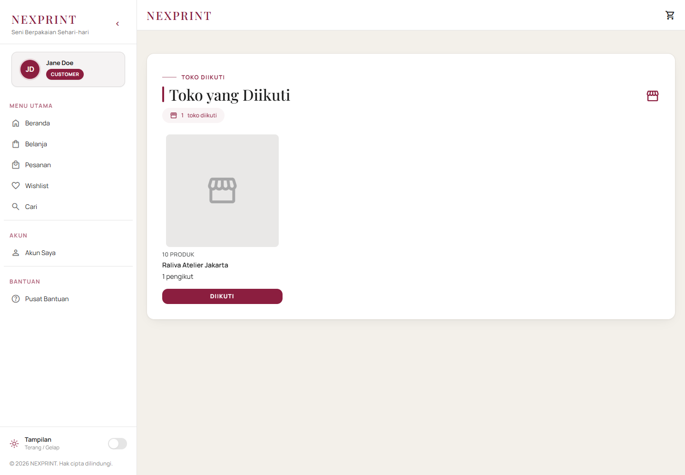
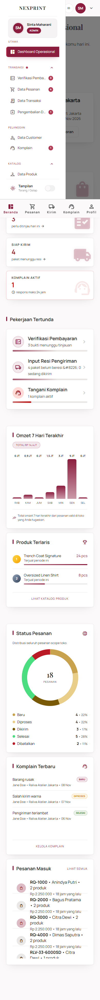

## 📸 UI QA evidence — ✅ PASS

**Verdict:** ✅ PASS
**Environment:** `http://localhost:8000` · role `SuperAdmin, Admin, Owner, Produksi, Gudang, Customer` · browser `Playwright Chromium`
**Verified:** main @ cc398756 (local worktree)

### Scenario (P0/P1 — dashboard, sidebar, logo, gauge)

| # | Step | Expected | Observed | Result |
|---|------|----------|----------|--------|
| 1 | Login SuperAdmin dan buka /superadmin/dashboard | Halaman dashboard tampil tanpa error | URL=http://localhost:8000/superadmin/dashboard; judul=NEXPRINT - Dashboard Admin Utama | ✅ |
| 2 | Buka sidebar SuperAdmin | Semua grup sidebar default terbuka dan item aktif ter-highlight | 6/6 grup terbuka; 1 item aktif; label: MANAJEMEN, TRANSAKSI, KEUANGAN, OPERASIONAL, PLATFORM, MONITORING | ✅ |
| 3 | Tutup grup sidebar SuperAdmin | Klik grup menutup submenu (aria-expanded=false) | aria-expanded=false; kelas=grid-rows-[0fr] | ✅ |
| 4 | Buka kembali grup sidebar SuperAdmin | Klik grup membuka submenu kembali | aria-expanded=true | ✅ |
| 5 | Periksa gauge SuperAdmin | Gauge omzet/kepuasan/SLA tampil dengan capaian 0-100% atau — + label status yang benar | [{"value":"100%","center":"dari Bulan Lalu","label":"dari Bulan Lalu"},{"value":"100%","center":"Rating 4,5 / 5","label":"Rating 4,5 / 5"},{"value":"100%","center":"Target 24 Jam","label":"Target 24 Jam"},{"value":null,"center":null,"label":"Toko Terdaftar"}] | ✅ |
| 6 | Periksa teks dashboard SuperAdmin | Ringkasan omzet, kepuasan, dan SLA terlihat | omzet, kepuasan, sla | ✅ |
| 7 | Console SuperAdmin | Tidak ada error JavaScript di console | Tidak ada error console/page | ✅ |
| 8 | Login Admin dan buka /admin/dashboard | Halaman dashboard tampil tanpa error | URL=http://localhost:8000/admin/dashboard; judul=NEXPRINT - Dashboard Operasional | ✅ |
| 9 | Buka sidebar Admin | Semua grup sidebar default terbuka dan item aktif ter-highlight | 3/3 grup terbuka; 1 item aktif; label: TRANSAKSI, KATALOG, LOGISTIK | ✅ |
| 10 | Tutup grup sidebar Admin | Klik grup menutup submenu (aria-expanded=false) | aria-expanded=false; kelas=grid-rows-[0fr] | ✅ |
| 11 | Buka kembali grup sidebar Admin | Klik grup membuka submenu kembali | aria-expanded=true | ✅ |
| 12 | Periksa identitas toko Admin | Nama toko nyata dan fallback ikon storefront tampil | nama toko=true; ikon storefront pada kartu identitas=1 | ✅ |
| 13 | Periksa progress tugas Admin | Progress tugas berupa angka 0-100% tanpa pembulatan palsu | width: 60% \| width: 60% \| width: 25% \| width: 100%; \| width: 33%; | ✅ |
| 14 | Console Admin | Tidak ada error JavaScript di console | Tidak ada error console/page | ✅ |
| 15 | Login Owner dan buka /owner/dashboard | Halaman dashboard tampil tanpa error | URL=http://localhost:8000/owner/dashboard; judul=NEXPRINT - Dashboard Toko | ✅ |
| 16 | Buka sidebar Owner | Semua grup sidebar default terbuka dan item aktif ter-highlight | 3/3 grup terbuka; 1 item aktif; label: OPERASIONAL, PENJUALAN, TIM & LAPORAN | ✅ |
| 17 | Tutup grup sidebar Owner | Klik grup menutup submenu (aria-expanded=false) | aria-expanded=false; kelas=grid-rows-[0fr] | ✅ |
| 18 | Buka kembali grup sidebar Owner | Klik grup membuka submenu kembali | aria-expanded=true | ✅ |
| 19 | Periksa header dan identitas Owner | Badge Terverifikasi, nama toko, dan ikon storefront tampil | badge=true; nama=true; storefront=1 | ✅ |
| 20 | Periksa aktivitas Owner | Daftar aktivitas memakai status/progress nyata tanpa error | item aktivitas terdeteksi=4; error teks=false | ✅ |
| 21 | Console Owner | Tidak ada error JavaScript di console | Tidak ada error console/page | ✅ |
| 22 | Login Produksi dan buka /produksi/dashboard | Halaman dashboard tampil tanpa error | URL=http://localhost:8000/produksi/dashboard; judul=NEXPRINT - Dashboard Produksi | ✅ |
| 23 | Buka sidebar Produksi | Semua grup sidebar default terbuka dan item aktif ter-highlight | 2/2 grup terbuka; 1 item aktif; label: PROSES PRODUKSI, BAHAN & TRANSAKSI | ✅ |
| 24 | Tutup grup sidebar Produksi | Klik grup menutup submenu (aria-expanded=false) | aria-expanded=false; kelas=grid-rows-[0fr] | ✅ |
| 25 | Buka kembali grup sidebar Produksi | Klik grup membuka submenu kembali | aria-expanded=true | ✅ |
| 26 | Periksa identitas Produksi | Nama toko yang ditugaskan tampil, label atelier hardcoded hilang | nama toko=true; hardcoded=false; storefront=1 | ✅ |
| 27 | Console Produksi | Tidak ada error JavaScript di console | Tidak ada error console/page | ✅ |
| 28 | Login Gudang dan buka /gudang/dashboard | Halaman dashboard tampil tanpa error | URL=http://localhost:8000/gudang/dashboard; judul=NEXPRINT - Dashboard Gudang | ✅ |
| 29 | Buka sidebar Gudang | Semua grup sidebar default terbuka dan item aktif ter-highlight | 1/1 grup terbuka; 1 item aktif; label: PERSEDIAAN | ✅ |
| 30 | Tutup grup sidebar Gudang | Klik grup menutup submenu (aria-expanded=false) | aria-expanded=false; kelas=grid-rows-[0fr] | ✅ |
| 31 | Buka kembali grup sidebar Gudang | Klik grup membuka submenu kembali | aria-expanded=true | ✅ |
| 32 | Periksa konteks gudang | Gudang aktif dan gudang lain yang ditugaskan tampil | gudang terdeteksi=Gudang Utama Jakarta, Gudang Cabang Bandung | ✅ |
| 33 | Periksa gauge Gudang | Gauge stok/akurasi/SLA menampilkan capaian 0-100% atau — + Belum Ada Data | [{"value":"0%","center":"dari Target"},{"value":"100%","center":"Akurasi"},{"value":"100%","center":"Stok Tersedia"},{"value":null,"center":null}] | ✅ |
| 34 | Console Gudang | Tidak ada error JavaScript di console | Tidak ada error console/page | ✅ |
| 35 | Buka Data Toko Owner | Logo kosong menampilkan ikon storefront dan preview gambar tersembunyi | fallback terlihat=true; preview tersembunyi=true | ✅ |
| 36 | Buka beranda customer | Kartu toko tanpa logo memakai ikon storefront | ikon storefront pada kartu toko=1 | ✅ |
| 37 | Ikuti toko dari halaman toko | Tombol follow berubah menjadi Diikuti | tombol follow=true; status diikuti=true; HTTP 200 | ✅ |
| 38 | Buka halaman toko diikuti | Toko tanpa logo memakai ikon storefront dan nama toko tampil | nama toko=true; storefront=1 | ✅ |
| 39 | Smoke dashboard Admin mobile 390x844 | Tidak ada overflow horizontal dan tombol sidebar mobile dapat dibuka | overflow=0px; tombol sidebar terlihat=true | ✅ |

### Screenshots

### Notes for QA
- Browser QA memakai data demo lokal hasil `RalivaDemoSeeder` (6 staff, 2 gudang, 18 pesanan).
- Empty-state gauge (`—` + `Belum Ada Data`) diverifikasi lewat feature test `DashboardSidebarRegressionTest`, bukan dengan menghapus data demo di browser.
- Tidak ada E2E browser test permanen di repo; skenario follow-up di bawah bisa dijadikan automation berikutnya.

## 🧪 Follow-up: add a UI/integration test

This change ships no browser-level test. The UI QA above was manual; lock it in with an automated browser test.

**Scenario (derived from the manual run above):**
1. Setup: seed demo roles/stores/staff and log in as each role.
2. Act: open each dashboard, verify all sidebar groups default open, toggle one group, then check the store identity/logo fallback and gauges.
3. Assert: no hardcoded atelier labels, no 100% gauge when data is empty, and customer/owner logo fallbacks show the storefront icon.
4. Teardown: delete every fixture created.
